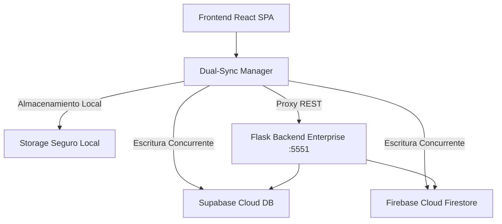

# Diseño Técnico: Arquitectura Dual Activo-Activo (Firebase + Supabase) & Backend Blindado

**Fecha:** 2026-11-13  
**Proyecto:** Riqsi Rutas Cochabamba  
**Estado:** Propuesto (Pendiente de Aprobación)

---

## 1. Intención y Propósito
El usuario requiere que la plataforma aproveche al máximo el ecosistema de **Firebase** (Cloud Firestore en tiempo real, Authentication y Hosting), manteniendo la misma robustez en **Supabase** (PostgreSQL Cloud) y eliminando cualquier punto débil en el **Backend Flask** (puerto 5551) para que no existan fallos de persistencia ni pérdida de datos ante recargas (F5) o caídas de red.

---

## 2. Objetivos y No-Objetivos

### Objetivos:
1. **Aprovisionamiento Firebase Automatizado:** Crear la Web App en el proyecto `riqsi-rutas`, extraer las credenciales oficiales y configurarlas en `.env`.
2. **Dual-Sync Activo-Activo (Frontend):** Al guardar o actualizar un destino, usuario o aviso, la aplicación replica los cambios simultáneamente en Supabase y Firestore mediante promesas concurrentes no bloqueantes (`Promise.allSettled`).
3. **Resiliencia en Lectura:** Al cargar la app, se consulta el proveedor primario disponible; si falla o está sin conexión, conmuta instantáneamente al secundario y al almacenamiento local seguro.
4. **Backend Flask Blindado:**
   - Validaciones estrictas de esquemas (precios numéricos, strings no vacíos, sanitización de payloads).
   - Manejo defensivo de excepciones con respuestas HTTP semánticas (`200`, `201`, `400`, `404`, `500`).
   - Sincronización dual desde el backend para endpoints REST (`/api/places`, `/api/users`, etc.).
5. **Despliegue Firebase Hosting:** Compilar la SPA optimizada y desplegarla en Firebase Hosting con reglas de seguridad Firestore (`firestore.rules`).

### No-Objetivos:
- No eliminar el fallback local seguro (`secureSet` / `secureGet`) que garantiza persistencia offline.
- No alterar las rutas de visualización de fotos locales ni el diseño estilístico de aguayo y Cochabamba.

---

## 3. Enfoques Considerados

### Enfoque A: Dual Activo-Activo / Sincronización Doble *(Seleccionado)*
- **Descripción:** Las escrituras se emiten a Supabase, Firestore y Flask en paralelo. La lectura prioriza la fuente más rápida y saludable.
- **Ventajas:** Cero tiempo de inactividad, sincronización en tiempo real con Firestore, tolerancia total a fallos.
- **Desventajas:** Requiere sincronización bidireccional cuidadosa para evitar conflictos de timestamps.

### Enfoque B: Conmutador Primario-Secundario (Switch Manual)
- **Descripción:** Solo un backend está activo a la vez según la variable `VITE_BACKEND`.
- **Ventajas:** Menor cantidad de llamadas concurrentes.
- **Desventajas:** Si el proveedor activo falla, el usuario debe conmutar manualmente y los datos quedan desfasados.

---

## 4. Componentes y Arquitectura

### 4.1. Firebase Configuration & Provisioning
- Crear la aplicación web usando Firebase CLI:
  `npx -y firebase-tools@latest apps:create WEB riqsi-rutas-web --project riqsi-rutas`
- Obtener el SDK Config oficial y poblar `.env`:
  `VITE_FIREBASE_API_KEY`, `VITE_FIREBASE_APP_ID`, etc.
- Generar `firestore.rules` con acceso controlado para usuarios autenticados y lectura pública de destinos turísticos.

### 4.2. Dual-Sync Manager en `src/services/`
- Actualizar `savePlace()`: emite `upsert` a Supabase y `setDoc` a Firestore en paralelo.
- Actualizar `fetchPlaces()`: lee desde Supabase o Firestore con fallback local automático.
- Listener en tiempo real `subscribeToPlaces()` compatible con Firestore `onSnapshot` y Supabase Realtime Channels.

### 4.3. Flask Backend Hardening (`flask-crud/app.py`)
- Tipado y validación de atributos enriquecidos (`precio`, `precio_usd`, `horario_visita`, etc.).
- Verificación de estado de salud dual en `/health` (reporta latencia y conectividad tanto a Supabase como a Firebase).
- Endpoints idempotentes `PUT /api/places/<id>`.

---

## 5. Criterios de Aceptación
1. `npx firebase-tools apps:list` muestra la Web App activa y `.env` tiene las claves reales.
2. Al editar cualquier lugar desde el frontend o Postman, el cambio se refleja en Supabase y Firestore.
3. Al recargar la página (**F5**), la información persiste exactamente como se dejó.
4. `npm run build` compila con 0 errores de TypeScript y Rollup.
5. El proyecto queda desplegable mediante `npx firebase-tools deploy --only hosting,firestore:rules`.

